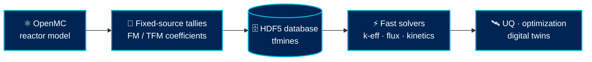

### ⚛️ Fast, accurate, open reactor physics, from fission matrices to digital twins

---

## 🌟 Who we are

**M-PRISM** is the Reactor Physics Group at the **Colorado School of Mines**, led by [Valerio Mascolino](https://www.vmascolino.com). We develop the computational tools that let reactor designers, regulators and operators get **Monte Carlo accuracy at a fraction of the cost**: validated against real experiments, built on open-source software, and aimed at the next generation of research, advanced and space reactors.

<table>
<tr>
<td align="center" width="25%"><h3>⚡ 10²–10⁴×</h3>typical speed-up of fission-matrix transport over direct Monte Carlo¹</td>
<td align="center" width="25%"><h3>🧪 Experiment-first</h3>validated on measured data from the JSI TRIGA Mark-II, not just code-to-code</td>
<td align="center" width="25%"><h3>🔓 Open by design</h3>OpenMC, Python and C++, with public model libraries</td>
<td align="center" width="25%"><h3>🌍 Collaborative</h3>JSI Ljubljana · Politecnico di Milano · Virginia Tech heritage</td>
</tr>
</table>

¹ Reported for the RAPID code system across its validation benchmarks (pre-calculation of the coefficient database excluded).

---

## 🔬 What we work on

| | Focus | In a sentence |
|---|---|---|
| 🧮 | **Fission Matrix & Transient Fission Matrix** | Recast neutron transport as a linear eigenvalue problem, so criticality, 3-D flux and full time-dependent kinetics solve in seconds, with no source-convergence headaches. |
| 🛠️ | **Open-source tooling for OpenMC** | Bringing fission-matrix and kinetics capability to the much larger OpenMC community. |
| 📚 | **Open reactor model library** | A growing, documented set of OpenMC reactor models that others can run, verify and extend. |
| 🎯 | **Experimental validation** | Control-rod worth, dosimetry, burnup and kinetics measured at the JSI TRIGA Mark-II (Ljubljana). |
| 🤖 | **AI/ML acceleration** | Neural networks for thermal-feedback modeling, interpolation and flux reconstruction on top of fission-matrix databases. |
| 🌙 | **Advanced reactors & space** | Heat-pipe microreactors, molten-salt reactors, research-reactor safety bases and lunar fission surface power. |

> 🧭 **Status note.** The method foundations (fission matrix, tRAPID kinetics, FM-CRd control rods) are published and experimentally validated. The OpenMC implementations, AI/ML acceleration and advanced-reactor applications below are **active development**, not finished results.

---

## 🧩 How the pieces fit

---

## 📦 Featured software

| Project | What it does | Status |
|---|---|---|
| 📚 [**CSM Open-Source Reactor Model Library**](https://github.com/M-PRISM-Colorado-School-of-Mines/CSM-Open-source-Reactor-Model-Library) | Independent, documented OpenMC models. First release: the **IAEA TECDOC-643** generic 10 MW LEU research reactor. Heat-pipe microreactor, lunar FSP, MSRE, pebble-bed HTGR and Radiant Kaleidos directories are reserved for upcoming models. |   |
| 🧮 **tfmines** | Transient Fission Matrix solver with OpenMC integration: extracts FM tallies from statepoints, solves for k-eff, fission source and importance, propagates coefficient uncertainties, and runs time-dependent kinetics (FM-CRd control rods, βeff, Λ, Rossi-α). Python by default, optional OpenMP C++ engine. |  |
| 🖥️ **slurm-manager** | Small Python library to prepare and submit Slurm jobs on a single-node workstation, built for the group's own compute. |  |

Other work in the lab includes OpenMC models of university research reactors (verified code-to-code against MCNP), TRIGA safety-basis modeling, and autonomy for lunar power systems.

---

## 📖 Selected publications from the method lineage

- **tRAPID**: *A Novel Hybrid Deterministic and Monte Carlo Neutron Transport Formulation and Algorithm for Accurate and Fast 3-D Reactor Kinetics*, Mascolino & Haghighat, **Nuclear Science and Engineering** 198 (2024)
- **Experimental validation of 3-D kinetics** on the JSI TRIGA Mark-II, Mascolino, Pungerčič, Snoj & Haghighat, **Progress in Nuclear Energy** 176 (2024)
- **FM-CRd**: *Development and Validation of New Algorithms for Control Rods Insertion Modeling in RAPID*, Mascolino, Haghighat & Snoj, **Annals of Nuclear Energy** 166 (2022)
- **Heat-pipe microreactors**: *The Fission Matrix Method for Criticality Search in Heat-Pipe Micro Reactors*, Vita et al., **Annals of Nuclear Energy** (2027)
- 📝 **Uncertainty quantification** *(preprint, under review)*: *Uncertainty Quantification for the Fission Matrix Method: A Rigorous Mathematical Framework and Computationally Efficient Alternatives*, Mascolino, submitted to **Nuclear Science and Engineering** · [arXiv:2609.33161](https://arxiv.org/abs/2609.33161)

---

## 🤝 Partners

| 🇸🇮 **Jožef Stefan Institute** | 🇮🇹 **Politecnico di Milano** | 🎓 **Virginia Tech** |
|:---:|:---:|:---:|
| TRIGA Mark-II experiments and validation → [JSI-Mines-Collaboration](https://github.com/JSI-Mines-Collaboration) | Fuel performance, fusion and multi-physics → [PoliMI-Mines-Collaboration](https://github.com/PoliMI-Mines-Collaboration) | Origin of the RAPID code system and the fission-matrix lineage |
| 🇮🇹 **Politecnico di Torino** | 🏛️ **University of Missouri** | |
| Fission-matrix methods for heat-pipe microreactors | Research-reactor modeling (MURR) | |

---

## 🚀 Get involved

- 🧑‍🎓 **Students**: we work with PhD, MS and undergraduate researchers across nuclear engineering and computational physics.
- 🔧 **Contributors**: open an issue or pull request on any public repository.
- 📬 **Collaborators**: reach out through [vmascolino.com](https://www.vmascolino.com).

